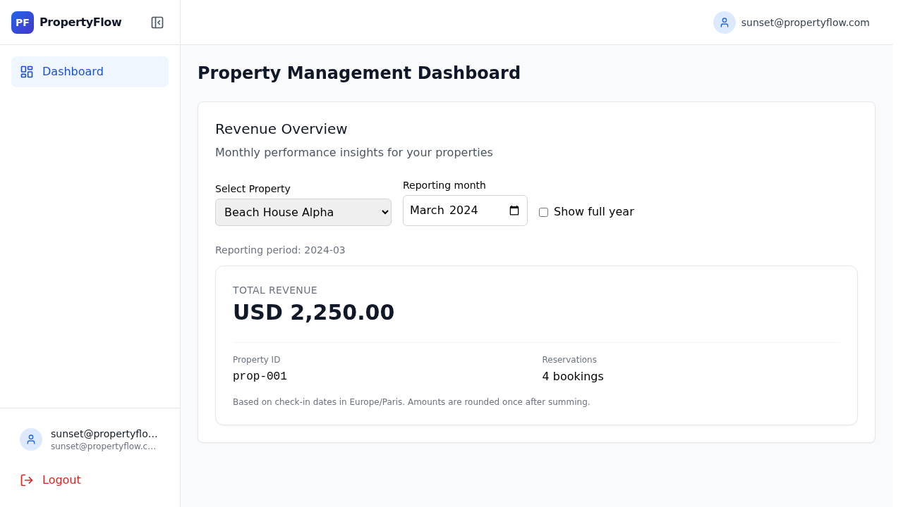
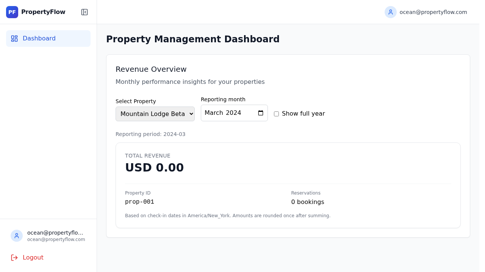

# Investigation and fixes

## Reproduction and expected results

I logged in with both accounts provided in `ASSIGNMENT.md` and requested March 2024 for `prop-001`. Before the fixes, both returned a successful response with `1000.0` and three bookings. The source showed that this was fabricated fallback data rather than the reservation sum. The second account could also receive the first account's cached result because the cache key omitted the tenant.

The repository intentionally reuses `prop-001` across two tenants. These are different properties:

| Tenant | Property | Time zone | Correct March revenue | Bookings |
| --- | --- | --- | --- | --- |
| Sunset Properties | Beach House Alpha (`prop-001`) | Europe/Paris | USD 2,250.00 | 4 |
| Ocean Rentals | Mountain Lodge Beta (`prop-001`) | America/New_York | USD 0.00 | 0 |
| Sunset Properties | City Apartment Downtown (`prop-002`) | Europe/Paris | USD 4,975.50 | 4 |
| Sunset Properties | Country Villa Estate (`prop-003`) | Europe/Paris | USD 6,100.50 | 2 |
| Ocean Rentals | Lakeside Cottage (`prop-004`) | America/New_York | USD 1,776.50 | 4 |
| Ocean Rentals | Urban Loft Modern (`prop-005`) | America/New_York | USD 3,256.00 | 3 |

Ocean's shared ID has no seeded reservations; zero is the correct result. No sample bookings were changed to make the demonstration work.

Sanitized live API captures: [before](evidence/before.json), [after](evidence/after.json). The after capture alternates tenants against the running API and real Redis and confirms that requests for foreign properties return 404.

## Root causes and changes

### 1. Shared cache keys leaked revenue between tenants

`backend/app/services/cache.py` used `revenue:{property_id}`. Because property identity is composite, a response cached for Sunset's `prop-001` was eligible to be returned to Ocean.

The new versioned key includes tenant, property, month, and year using an unambiguous JSON tuple. Versioning prevents old polluted entries from being reused. Cached identity and payload fields are validated before returning a hit. Redis failures fall back to the database; database failures are not cached. The existing five-minute TTL remains.

### 2. The database path did not use the configured database

`database_pool.py` constructed its URL from nonexistent legacy Supabase database settings, selected a synchronous queue pool for an async engine, and exposed an async session factory that callers incorrectly used as a context manager. The revenue service instantiated a new pool per call and caught every error, returning hard-coded mock totals.

The repaired shared pool reads `DATABASE_URL`, uses SQLAlchemy's async-compatible pooling, initializes once, exposes the session correctly, and closes at application shutdown. The asyncio SQLAlchemy dependency and PyJWT import dependency are explicit. Fabricated revenue has been removed; outages return 503 rather than successful financial reports.

### 3. Monthly calculations were disconnected and ignored local time

`calculate_monthly_revenue` built naive date boundaries and returned zero without querying the database. The endpoint exposed only all-time revenue, despite the dashboard describing monthly performance.

Monthly, annual, and all-time requests now use the same calculation. Each property is looked up by both tenant and property ID. Local calendar boundaries are constructed with `ZoneInfo`, converted to aware UTC instants, and queried using `start <= check_in_date < end`. This handles leap years, December rollover, and changes in UTC offset.

For Paris March 2024 the UTC interval is `[2024-02-29 23:00, 2024-03-31 22:00)`. The seeded check-in at February 29, 23:30 UTC is March 1, 00:30 in Paris, so its USD 1,250 belongs to March. February correctly returns zero. The interval changes length across DST; adding a fixed number of hours would be incorrect.

### 4. Exact money was converted to floating point

The API converted the service's decimal total to `float`, and the UI rounded again using JavaScript `Math.round`. This made precision and rounding depend on the transport/display layers.

PostgreSQL sums `NUMERIC` amounts exactly. Python keeps `Decimal`, rounds once with `ROUND_HALF_UP`, and serializes a fixed two-decimal string. The UI formats that string without a numeric conversion. The seeded `333.333 + 333.333 + 333.334` remains exactly `1000.000`. A regression with a half-cent boundary checks the explicit rounding policy.

The three-decimal source amounts are preserved. Reporting uses two decimal places as in the supplied USD dashboard; currency-specific minor-unit rules are outside this patch. Rows of different or unspecified currencies are rejected with 422 instead of being combined or labeled USD. A single non-USD currency retains its actual label. Empty reports use the schema's default USD currency because properties have no currency field.

### 5. Property selection and async UI state could mislead users

The dropdown exposed a global static list, including other tenants' properties and an incorrect label for Ocean's shared property ID. Revenue requests had no period and could resolve after another selection.

The existing dashboard now fetches its property list from a tenant-scoped endpoint and sends explicit month/year filters. Foreign and unknown property IDs both return 404. The tenant comes only from authenticated server context; a missing tenant returns 403. Responses use `Cache-Control: no-store`. Account/selection changes remount the revenue panel, and effect cleanup ignores outdated responses. The fabricated 12% growth badge was removed.

### 6. Authentication and session integration weakened isolation

The challenge fallback accepted a static token and decoded JWTs without verifying signatures. Cached auth could outlive JWT expiry. The alternate login path looked up an email without checking its password. Tenant resolution could silently default to Sunset.

The dashboard and `/auth/me` now use the verified user's tenant and fail closed when it is absent. The mock fallback verifies signature, audience, and expiry; the static bypass is gone. Cached authentication is bounded by token expiry. Only the two supplied credential pairs work in local challenge mode; configured Supabase authentication checks the password. This is targeted protection for the exercised login/dashboard path, not a claim of a full audit of every legacy endpoint.

Browser testing also found that the local auth adapter returned different shapes from the session consumers. It now returns the expected `data.user`/`data.session`, validates a user when restoring tokens, and preserves the authenticated tenant. Recovery handles an absent Supabase URL. The synchronous React Query persister now uses synchronous session storage instead of trying to JSON-parse an IndexedDB Promise.

## Verification

- **43 tests passed** locally and in [GitHub Actions on PostgreSQL 15](https://github.com/camie-ace/New_devs_App/actions/runs/40357171367). The [captured CI result](evidence/ci-tests.txt) records the passing test step.
- [Silent browser verification recording, 45 seconds](evidence/demo.mp4). To reproduce it with the Playwright CLI: open the running frontend, run `playwright-cli video-start demo.webm --cursor`, run `playwright-cli run-code --filename=scripts/capture-demo.js`, then run `playwright-cli video-stop`. The separate Loom outline covers the required explanation of root causes and fixes.
- Regression suite passed against real PostgreSQL with isolated schemas: both provided login accounts; cache warm-up in both tenant orders; monthly/yearly/all-time totals; foreign property access; signed/unsigned/expired/missing-tenant tokens; expired auth cache; wrong passwords; exact sums; half-cent rounding; local month boundaries; leap years; DST; mixed currencies; Redis failures; and database failure behavior.
- Production frontend build passed.
- The dashboard and revenue components pass ESLint. Linting the touched legacy frontend modules still reports pre-existing issues; [the baseline comparison](evidence/lint-comparison.json) checks the original snapshot against the solution without adding new rule violations. The rewritten Python services and tests pass Ruff.
- Browser checks: Sunset March `2250.00 / 4`; February `0.00 / 0`; annual selection; Ocean tenant-only property names; Ocean `prop-001` `0.00 / 0`; logout/login and page reload. The repaired login and dashboard have no browser console errors in the final session.
- Live API checks used the running application, seeded PostgreSQL and real Redis; see the sanitized captures above.
- A browser check delayed a previous property's response by 700 ms, switched to a different property, and verified that the delayed response could not overwrite the new selection's total.

The local Docker daemon lacked Compose and the first PostgreSQL image pull exhausted the host disk. Runtime verification therefore used the existing PostgreSQL 16 image, a dedicated Redis container, and the native backend/Vite processes. CI uses the assignment's PostgreSQL 15 version. The higher-level test harness could not launch its missing bundled Chromium executable; browser verification and recordings use the installed Playwright CLI with Chrome instead.

## Assumptions and boundaries

Revenue belongs entirely to the property's local check-in period, consistent with the supplied service's date filter; this is not nightly revenue proration. Monthly/annual totals round once per reporting period, so adding already rounded monthly totals can differ from an independently rounded annual total.

The cache's existing five-minute freshness window remains. There is no booking-write endpoint in the assignment to connect invalidation to. The original schema enables RLS without policies and uses a privileged development database user, so the repaired queries enforce tenant scoping explicitly. A production RLS/credential deployment is a separate concern. The patch preserves the existing architecture and seed data.
